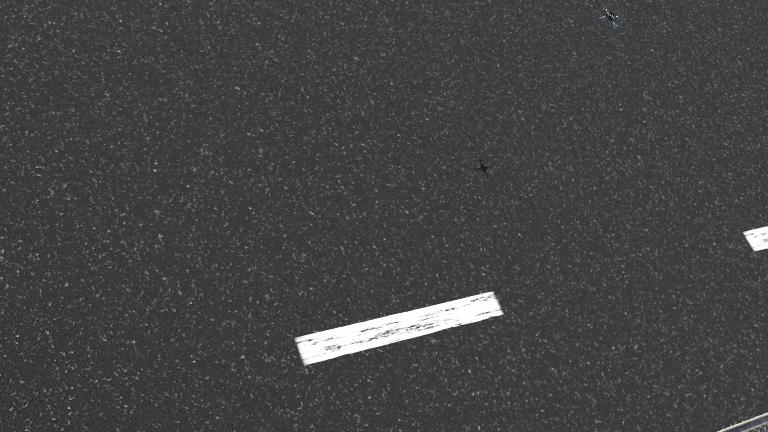
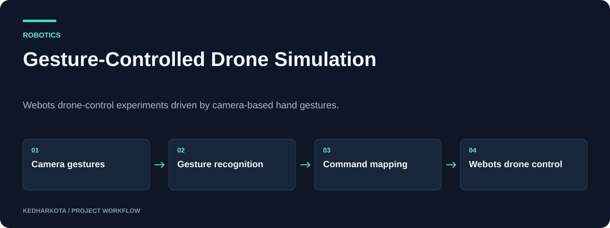

# Gesture-Controlled Drone Simulation

Webots drone-control experiments driven by camera-based hand gestures.

**Python · Webots · OpenCV · MediaPipe · TensorFlow · PID**

[](https://github.com/kedharkota/Gesture-Controlled-Drone-/actions/workflows/docs.yml)

[Overview](#overview) · [Getting started](#getting-started) · [Repository guide](#repository-guide) · [Reproducibility](docs/REPRODUCIBILITY.md)

<p align="center">
  
</p>

[Open full-size visual](docs/assets/simulation.jpg)

*Original saved Webots world preview from Robotics.zip.*

## Project at a glance

| Detail | Project information |
| --- | --- |
| **Focus** | Gesture recognition connected to simulated drone control |
| **Start here** | [Robotics.zip](Robotics.zip) |
| **Run mode** | Archived Webots project; controller paths need local configuration |
| **Explore** | World files, controller variants, gesture models, and saved previews |

## Overview

A Webots robotics project archived in `Robotics.zip`, combining gesture recognition with simulated drone control. The archive contains controller variants, model files, PID utilities, robot prototypes, and simulation worlds.

## What this project includes

- OpenCV/MediaPipe camera processing and TensorFlow gesture-classification variants.
- Gesture-to-flight-command mappings and controller experiments.
- Crazyflie-related control code, sensor utilities, and PID helpers.
- Webots worlds, prototypes, and saved simulation assets.

## Workflow

<p align="center">
  
</p>

[Open full-size visual](docs/assets/overview.svg)

*Explanatory diagram. Detailed implementation and availability notes follow below.*

## Getting started

Extract `Robotics.zip` locally. The archive's world header identifies **Webots R2023b**. Review the extracted `cutchesta/worlds/` and controller directories before opening a world in a compatible Webots installation.

Configure Webots to use a Python environment containing the controller's imported packages, including OpenCV, NumPy, MediaPipe, and TensorFlow where required. The `controller` module comes from Webots, rather than a generic pip package.

### Required inputs and current constraints

Several controller variants contain machine-specific absolute paths for gesture models and command files. Update them to the extracted paths and check model input dimensions and label ordering. Verify which controller a world assigns to its robot; not every bundled world is a complete drone demo. Camera-driven controllers need a working webcam.

## Repository guide

| File | Purpose |
| --- | --- |
| [Robotics.zip](Robotics.zip) | Archived cutchesta/ Webots project with worlds/, protos/, controllers/, and gesture models. |

## Results and project status

The archive contains source, learned gesture-model files, saved frames, and world previews. The preview above is an original saved world preview from the archive, not a new simulation run. Controller integration, gesture accuracy, and flight behavior were not executed during documentation preparation.

## Next steps

- Extract the maintainable source into browsable repository directories.
- Choose one canonical world/controller combination and document its gesture map and tested environment.

## Documentation maintenance

<details>
<summary>Run documentation checks and maintain visuals</summary>

Local documentation links and image headers are checked on pull requests and relevant pushes by the [documentation workflow](.github/workflows/docs.yml). Run the same check locally:

```bash
python tools/check_docs.py
```

See the [reproducibility guide](docs/REPRODUCIBILITY.md) for evidence, missing artifacts, and visual-source notes. The check validates documentation files; it does not train models or certify application behavior.

</details>

## Explore related projects

- [Robotic Vacuum Navigation Study](https://github.com/kedharkota/Implementation-and-Analysis-of-Advanced-Navigation-Algorithms-for-Robotic-Vacuum-Cleaners-)
- [Network Routing with Tries & Dijkstra](https://github.com/kedharkota/Advanced-Data-Structures-and-Algorithms)

---

[More projects by kedharkota](https://github.com/kedharkota?tab=repositories)
